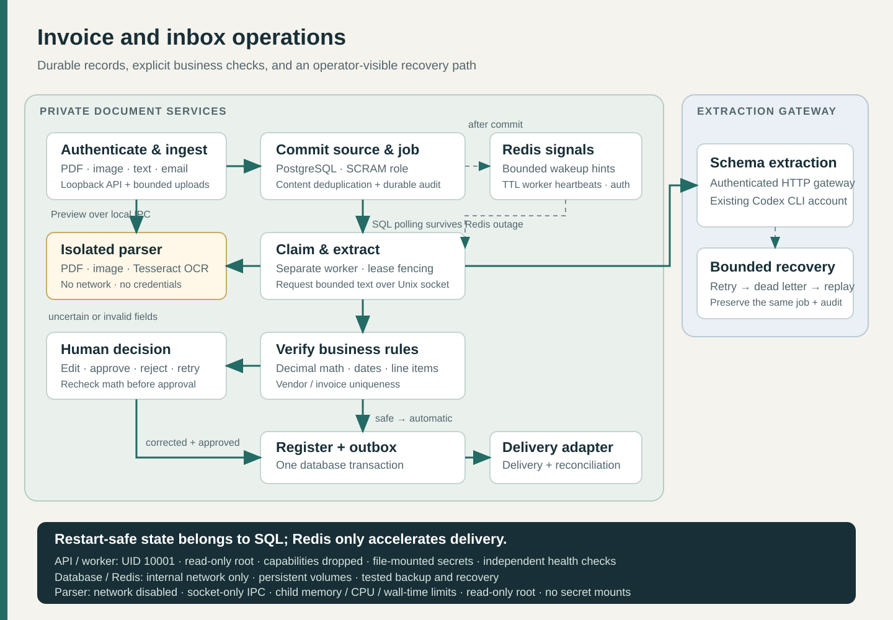

# Northstar Document Operations

Turn invoice PDFs, scans and mailbox attachments into a validated processing queue, with a review screen for exceptions and a durable record of every decision.

Northstar keeps the original source before extraction starts. It checks decimal arithmetic independently of model output, prevents duplicate postings and recovers work after a worker loses its lease. A failed provider or unavailable mailbox leaves a retryable job rather than a lost document.



## What it does

- Accepts authenticated uploads, text requests and `.eml` attachments; optional read-only IMAP intake and TLS SMTP delivery.
- Extracts PDF text and uses Tesseract for scanned pages. Parsing runs in a credential-free, network-isolated container with bounded child processes.
- Validates structured invoice fields, line totals, tax, currency and confidence. Exceptions require an explicit human decision with a reason and revision check.
- Stores source bytes, idempotency receipts, queue leases, invoice records, outbox and audit events in PostgreSQL. SQLite is available for local development.
- Uses Redis for bounded wake-up hints and heartbeat visibility. SQL remains the source of truth when Redis is unavailable.
- Includes an LLM gateway with a restricted Codex CLI adapter, bounded concurrency, deadlines and schema validation. Paid API adapters require explicit opt-in; there is no silent provider fallback.

The scope is a **single organization operated by trusted reviewers**. Client IDs organize documents; they are not authorization boundaries. Northstar does not pay invoices or post to a commercial accounting system. See [deployment](docs/DEPLOYMENT.md) before processing real documents.

## Try it without external credentials

Requirements: Docker Engine with Compose v2, Python 3.12+ for the bootstrap/check scripts, Linux containers on x86-64. The gateway image currently includes the reviewed Linux x86-64 Codex binary.

```sh
python scripts/bootstrap.py --fixture
docker compose pull --ignore-buildable
docker compose build
docker compose up -d --wait
python scripts/smoke.py
```

Open **http://127.0.0.1:18113** and paste the key from `.secrets/api_key`. This command deliberately selects a deterministic fixture provider. It is useful for evaluating the queue, OCR and review behavior; it is not live AI extraction. The fixtures contain only fictional records.

## Live extraction

Authenticate your own supported Codex CLI account and keep its auth file outside this repository. Review the provider version/security boundary in [gateway/README.md](gateway/README.md). No subscription or API credit is included with Northstar.

```sh
python scripts/bootstrap.py
# Set CODEX_AUTH_FILE to the absolute private path of your authenticated auth.json.
docker compose -f compose.yaml -f compose.codex.yml up -d --build --wait
python scripts/smoke.py --live
```

`bootstrap.py` switches the configured provider explicitly and preserves existing generated keys. Live extraction can transmit document text to the selected provider. Obtain authorization for that processing. The production profile fails readiness when its provider is unavailable; it never substitutes fixture output.

## Documentation

| Topic | Guide |
| --- | --- |
| First start, native development, API examples | [Setup](docs/SETUP.md) |
| States, transactions, leases and outbox | [Architecture](docs/ARCHITECTURE.md) |
| TLS, network exposure, secrets and operations | [Deployment](docs/DEPLOYMENT.md) |
| Mailbox credentials and reconciliation | [Mail integration](docs/MAIL.md) |
| Full test matrix and failure injection | [Testing](docs/TESTING.md) |
| Backup, restore, replay and incident response | [Runbook](docs/RUNBOOK.md) |
| Threat model and vulnerability reporting | [Security](SECURITY.md) |
| Release validation | [Validation](docs/VALIDATION.md) |

## Development

```sh
python -m venv .venv
# Activate .venv using your shell's normal command.
python -m pip install --require-hashes -r requirements-dev.lock
python -m pytest -q
python -m ruff check docops tests scripts
```

Tesseract with English trained data is required for OCR tests; the container installs it. Run the container suite for Linux parser limits and real PostgreSQL/Redis coverage. [Contributions](CONTRIBUTING.md) should include a failing regression case for behavioral fixes.

## License

Copyright 2026 Kiasha Mohammadi. Released under **GNU AGPL v3 or later**. See [LICENSE](LICENSE) and [third-party notices](THIRD_PARTY_NOTICES.md). PyMuPDF/MuPDF is AGPL/commercial licensed. This project does not grant a commercial license for third-party software. Network deployments and distribution must meet applicable source-availability obligations.

## Maintainer

Kiasha Mohammadi ([@kiawmo](https://github.com/kiawmo)). Use repository issues for reproducible bugs and proposals, and the private reporting process in SECURITY.md for vulnerabilities. Source changes, dependency updates and releases are maintained in this repository.
